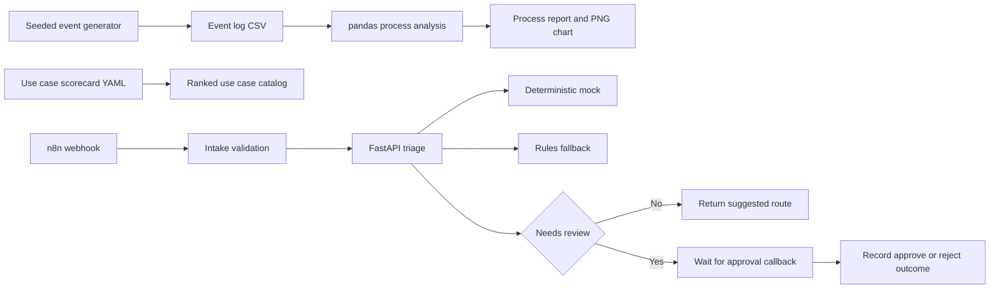

# Logistics AI Automation Lab

A small prototype for finding and testing automation ideas in corporate mail and parcel handling, dispatch, driver bookings and warehouse orders. **All data is synthetic.** A seeded generator simulates the event log. A second seeded generator builds the labeled benchmark from fictional, manually labeled scenarios.

## Architecture



## Run

GitHub Actions runs the entire demo on Linux with Python 3.12 and Node 24. It installs dependencies from public package registries, generates the inputs and reports, runs the test suite, and runs the imported workflow on loopback. The demo uses no service accounts, API keys or containers.

To reproduce on Linux from the repository root:

```bash
python -m pip install '.[dev]'
logistics-lab generate --count 3000 --seed 2829 --output artifacts/events.csv
logistics-lab analyze --events artifacts/events.csv --out artifacts/process
logistics-lab rank
logistics-lab make-benchmark --seed 2829 --output artifacts/triage-benchmark.csv
logistics-lab evaluate --cases artifacts/triage-benchmark.csv --out artifacts/evaluation
pytest -q --cov=logistics_lab
ruff check
bash scripts/n8n-smoke.sh artifacts/n8n
```

For the FastAPI service alone, run `python -m uvicorn logistics_lab.api:app --host 127.0.0.1 --port 8000`. Send `POST /triage` with `{"request_id":"SYN-DEMO","text":"Trace a parcel in the mailroom."}`. The response includes the category, confidence, review flag, and engine. The `LLM` protocol accepts a replacement provider. The independent rules fallback handles provider unavailability, timeout or invalid output.

The n8n smoke command imports and publishes [the workflow](workflow/logistics-triage.json) in a temporary local instance. The test submits invalid and valid intake, then sends synthetic approve and reject decisions to the Wait node's callback. The log records the actual HTTP outcomes and omits the resume URL.

## Reading the outputs

| Output | What it measures |
| --- | --- |
| `events.csv` | One row per status entry with a case ID, sequence, UTC timestamp, request type and priority. |
| `process-report.md` and `step-times.png` | Time to the next event by step, the p90 bottleneck ranking, and request-level rework. Incomplete traces contribute observed intervals. The end-to-end median uses completed cases. |
| `directly-follows.csv` | Counts of adjacent activity pairs within a single request, including rework loops. The report embeds the same graph in Mermaid. |
| [Use case catalog](docs/use-cases.md) | Seven hypotheses ranked by impact, effort and risk. Scores reflect workshop assumptions. |
| [Triage benchmark](docs/triage-evaluation.md) | Exact category accuracy across the entire labeled set, the confusion matrix and every error, including confident errors that escaped review. |
| [n8n run log](docs/n8n-run.log) | A successful Actions execution of the published workflow against FastAPI. |

## Knowledge base

- [Experiment log](docs/experiments.md)
- [Best practices](docs/best-practices.md)
- [30-minute colleague session](docs/colleague-session.md)

## Verification

Actions uploads the generated CSVs, benchmark results and chart as `logistics-demo`. The `n8n-run` artifact contains the webhook execution log. [GitHub Actions workflow](https://github.com/hamza2829/logistics-ai-automation-lab/actions/workflows/ci.yml)

## Limits

The event log and request text are synthetic. Queue times and rework rates reflect simulation inputs. The mock uses deterministic phrase matching, and the scores are heuristics. The benchmark describes behavior on the labeled scenarios only. The workflow demonstrates a loopback approval callback with simulated decisions and no operational side effects. SAP integration, real logistics records and a live LLM are outside the scope of this prototype.
