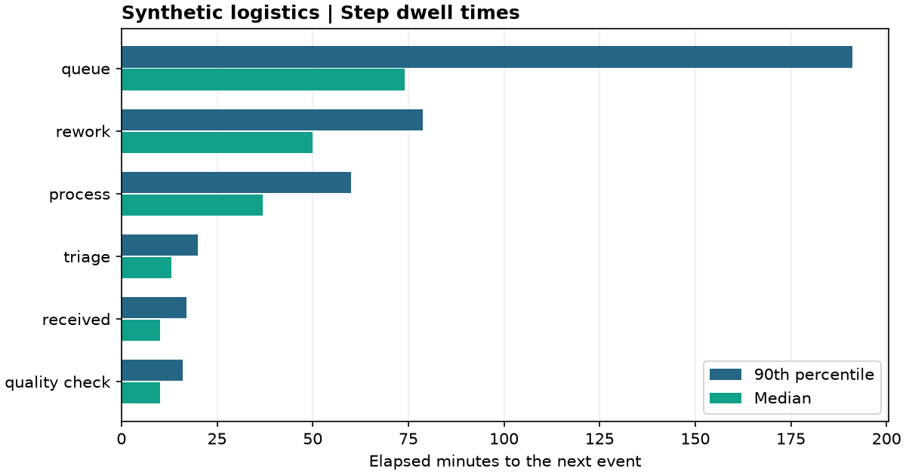
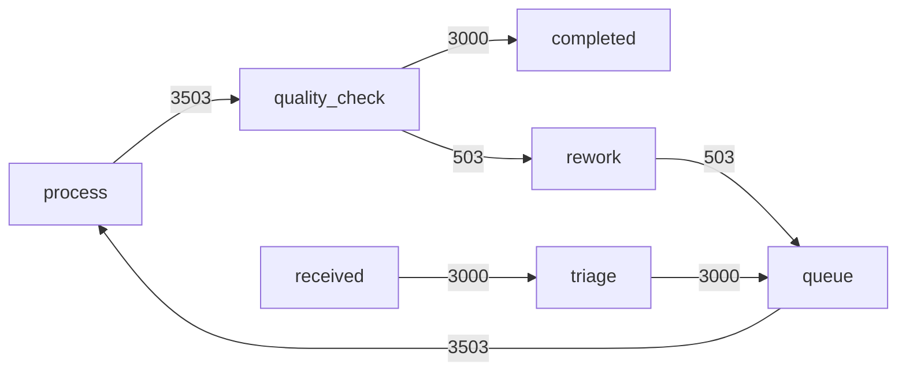

# Synthetic logistics process report

- Requests observed: 3,000 across 20,012 events.
- Completed requests: 3,000. Median completed cycle: 155.0 min.
- Rework: 427 requests (14.23%) with 503 rework visits.

Step dwell is elapsed time from a step's entry to the next event in the same request. The last event has no measured interval. Request cycle time uses completed traces only.

## Bottlenecks by 90th percentile dwell

| Step | Intervals | Median min | P90 min | Total min |
| --- | ---: | ---: | ---: | ---: |
| queue | 3,503 | 74.0 | 191.0 | 333051.0 |
| rework | 503 | 50.0 | 78.8 | 25250.0 |
| process | 3,503 | 37.0 | 60.0 | 131059.0 |
| triage | 3,000 | 13.0 | 20.0 | 38368.0 |
| received | 3,000 | 10.0 | 17.0 | 29800.0 |
| quality_check | 3,503 | 10.0 | 16.0 | 34821.0 |

## Directly follows graph

Edge labels count adjacent events within requests. Repeated visits count separately.
The simulated bottlenecks reflect generator assumptions.
